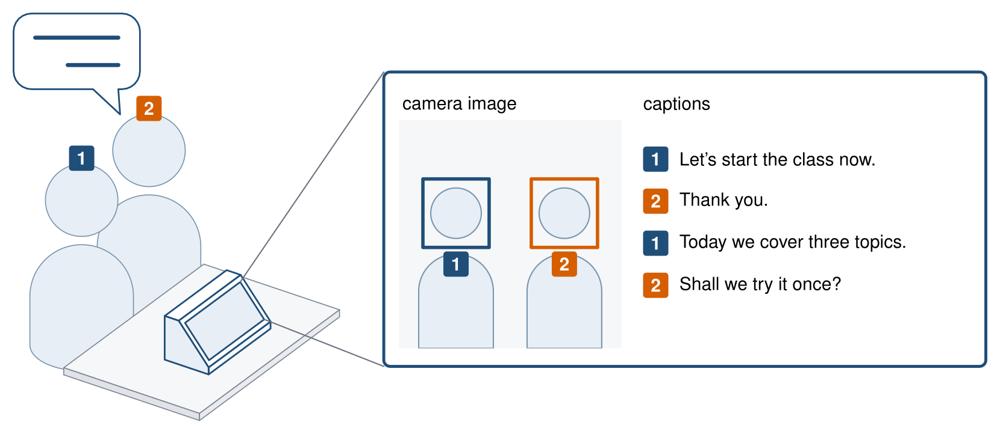
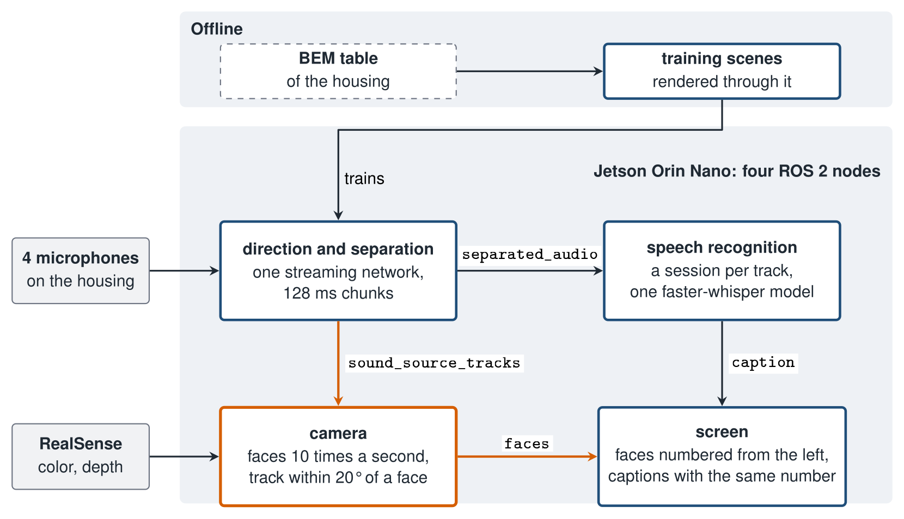
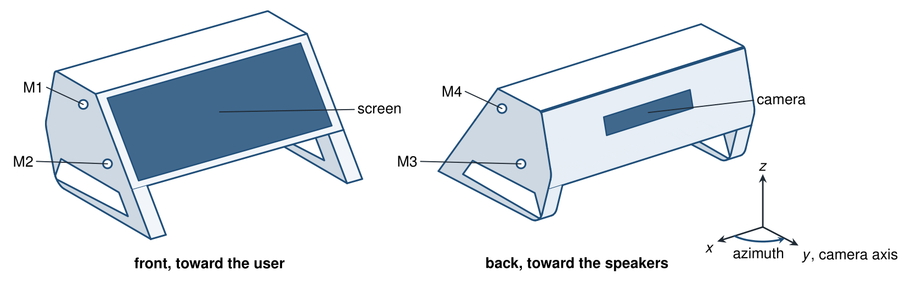
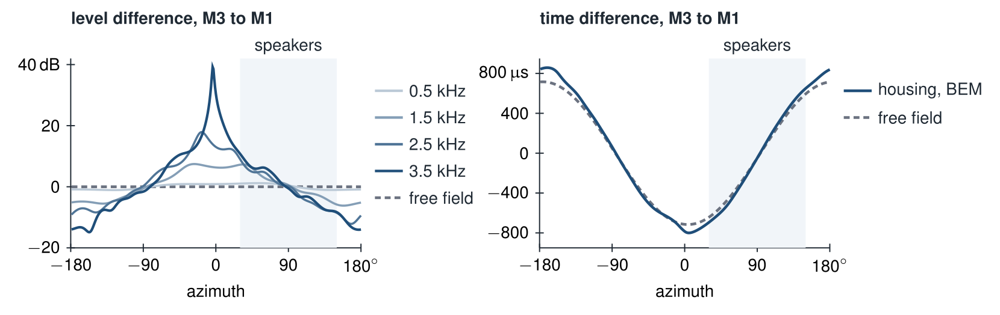
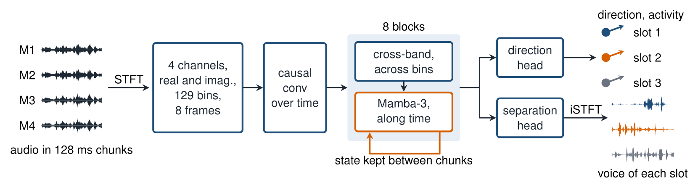
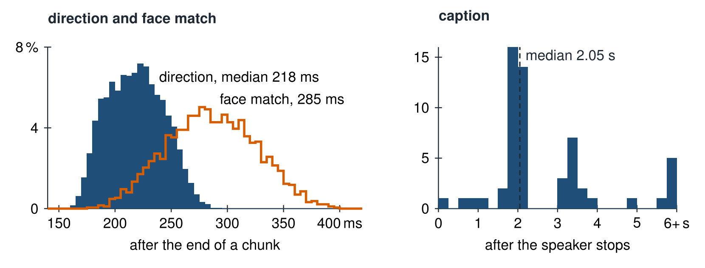

# Live Caption Device

A tabletop device that gives deaf and hard-of-hearing people live captions with a number for each speaker, the same number that marks the speaker's face on its screen. No one wears a microphone: four microphones on the housing find who is speaking, and everything runs offline on a Jetson Orin Nano inside the device. Built for the 24th Embedded Software Contest (2026).



On the device, the speakers' directions come 0.22 s after the end of each 128 ms chunk of audio and are matched to faces 0.29 s after it, and a caption appears 2 s after the speaker stops (medians over six sessions recorded on the device).

**Technical summary**

- **Four microphones to numbered captions.** Four ROS 2 nodes: direction and separation, face matching, speech recognition, and the screen.
- **Training data for this housing.** Every training voice is rendered through the housing's acoustic response, computed with the boundary element method (BEM) for 65,160 directions.
- **One streaming network.** Mamba-3 layers keep their state from one 128 ms chunk to the next, and one network gives each speaker's direction, voice activity and separated voice.
- **One recognition model for every voice.** Each speaker's track has its own streaming faster-whisper session, and all sessions share one model.

## Problem and users

Speech-to-text captions show what was said but not who said it. A deaf user who looks around for the speaker misses the next sentence. Products that label captions by speaker either give every speaker a microphone to wear or use one microphone, which cannot tell where a voice comes from.

The device stands on the table between the user and the people talking, in a lecture or a meeting. The screen faces the user; the camera and the microphones face the people. Everything runs on the device, so no audio leaves it and the captions do not depend on a network.

## Design requirements

| Requirement | How it is met |
|---|---|
| No microphone on the speakers | Four microphones on the housing |
| Up to three people at once | The network separates and locates up to three voices in every chunk |
| Caption and face carry the same number | A voice direction within 20 degrees of a face takes that face's number |
| Captions sentence by sentence as people talk | The network runs on the live stream; recognition decodes each sentence after a 0.7 s pause |
| Everything on one 8 GB board | Network, recognition and camera processing share the Jetson Orin Nano |

## System architecture



| | |
|---|---|
| Existing | ROS 2 Humble, faster-whisper `small` (Korean), MediaPipe BlazeFace, RealSense SDK, `mamba-ssm` (Mamba-3 layers), pyroomacoustics; LibriSpeech, Zeroth-Korean, NOISEX-92 and ESC-50 for the training audio |
| Developed here | training-scene generator (`training_data/`), the network and its training (`model/`, `training/`), the four ROS 2 nodes, their messages and the screen |
| Developed separately | the BEM solver that computed the housing's table, published as [stl2bem](https://github.com/Kwon-Junhyeong/stl2bem) |

The nodes run as separate processes because they run at different rates and loads: the network every 128 ms, face detection ten times a second, recognition whenever a sentence ends.

## Housing and microphones



The housing is 245 × 174 × 118 mm, with the screen on the slanted face toward the user and a RealSense D455 behind the back face. Two microphones sit on each end face, offset in height. The origin is the center of the four microphones, +x points out of the end face with M3 and M4, +y is the camera axis and +z points up; azimuth runs from +x toward +y, so 90 degrees is straight in front of the camera.

| Microphone | x (mm) | y (mm) | z (mm) |
|---|---|---|---|
| M1 | -122.50 | 9.50 | 23.59 |
| M2 | -122.50 | -30.49 | -23.59 |
| M3 | 122.50 | 25.20 | -23.59 |
| M4 | 122.50 | -4.20 | 23.59 |

**Two microphones on each end face rather than four on one face.** On the earlier box-shaped housing, in simulation (400 single-speaker scenes of 1 s), four microphones on one face gave a median error of 7.1 degrees in front of the array and 16.4 degrees behind it; two on each of two opposite faces gave 7.3 and 7.4 degrees.

## Training data through the housing



**The housing's response instead of a free-field model.** The body shadows the far microphones and bends the sound around itself. Between M3 and M1, over 300 to 3800 Hz in the horizontal plane, the level difference reaches 41.1 dB where a free-field model gives none, and the time difference spans -800 to +858 microseconds instead of plus or minus 716. In a simulation of this housing (200 single-speaker scenes), a search over steering vectors from the BEM table found the speaker's azimuth with a median error of 1.3 degrees, against 6.4 degrees with free-field steering vectors and 8.0 degrees with free-field SRP-PHAT.

The table covers 360 × 181 directions and 257 frequencies from 0 to 4 kHz on a mesh of 8,364 elements, whose longest edge (11.79 mm) is below a sixth of the 4 kHz wavelength. A rigid box of the housing's size has 53 interior resonances below 4 kHz, where the plain boundary integral equation has no unique solution; the solver adds the equations of 20 interior CHIEF points and solves by least squares, as checked against Burton-Miller in [stl2bem](https://github.com/Kwon-Junhyeong/stl2bem#interior-resonances-cbie-with-chief-points).

`training_data/generate.py` writes the scenes at 8 kHz:

- a room of 5 to 12 m by 5 to 12 m with a 2.4 to 3.5 m ceiling and a reverberation time of 0.2 to 1.3 s, the device 0.45 to 1.25 m above the floor;
- no speaker in 12 % of the scenes, otherwise one to three, 1.5 to 4.5 m away horizontally, between 30 and 150 degrees azimuth and -10 and 35 degrees elevation, at least 10 degrees apart;
- every image source of the room, up to the 17th order, filtered by the housing's response for its own direction (`reverb_synth.py`);
- diffuse noise with the coherence the housing gives it (`body_noise.py`) at 0 to 25 dB SNR, sensor noise, and up to 4 dB of gain error per channel;
- another speaker outside 30 to 150 degrees in 20 % of the scenes, a sound such as coughing or typing in 25 %;
- LibriSpeech and Zeroth-Korean speech, no speaker shared between training and validation.

The network was trained on 21,000 scenes of 4 s (600 for validation), of which 2,556 have no speaker and about 6,100 each have one, two or three, and then on 6,000 scenes of 32 s (300).

```sh
# LIBRISPEECH, ZEROTH_KOREAN, NOISEX92 and ESC50 point to the corpora
python training_data/generate.py HOUSING_TABLE.h5 OUT_DIR -n 21000 --split train --min_sep_deg 10
python training_data/generate.py HOUSING_TABLE.h5 OUT_DIR -n 600 --split dev --min_sep_deg 10
python training_data/generate.py HOUSING_TABLE.h5 LONG_DIR -n 6000 --split train --min_sep_deg 10 --t_sec 32
python training_data/generate.py HOUSING_TABLE.h5 LONG_DIR -n 300 --split dev --min_sep_deg 10 --t_sec 32
```

## One network for direction and separation



**A learned estimator instead of GCC-PHAT and steering-vector search.** GCC-PHAT was tried first. The pairs across the body are 245 to 251 mm apart, so their phase differences are unambiguous only below 682 to 699 Hz, and the estimates split into several directions. The steering-vector search above finds one speaker well, but with two speakers at once fewer than half of them came within 10 degrees (42 % with the BEM table). The network handles up to three speakers, tells how many are talking through its activity outputs, and needs no table at run time.

The network follows the cross-band and narrow-band layout of SpatialNet. Each of eight blocks mixes the 129 frequency bins of a frame and then runs two Mamba-3 layers along time for each bin, so level and phase cues at other frequencies can resolve a bin whose phase is ambiguous. The Mamba-3 layers carry their state from one chunk to the next, and the network runs on a stream of 128 ms chunks (8 frames of 16 ms); changing the input after frame 40 leaves the outputs of frames 0 to 39 exactly unchanged. It has 1,978,851 parameters. A state size of 16 was chosen over 64: a block ran in the same time (1.15 against 1.16 ms on an RTX 4060 Ti) with a quarter of the state.

The separation head gives a complex spectrum for each of three slots, and the direction head a unit vector and an activity per slot and frame. `training/train.py` assigns slots to speakers by the permutation of lowest cost and sums three losses: one minus the cosine to the true direction on active frames (weight 3), binary cross-entropy on activity (weight 1), and negative SI-SDR against the speaker's direct sound at M1 (weight 0.4).

| Training stage | Median direction error | SI-SDR improvement |
|---|---|---|
| 1. 4 s scenes, from scratch, 5 epochs | 5.05° | 9.12 dB |
| 2. 4 s scenes, learning rate 1e-4, 6 epochs | 4.71° | 9.17 dB |
| 3. 32 s scenes, 2 epochs, best after the first | 4.40° | 10.07 dB |

Each stage is evaluated on the 300 validation scenes of 32 s; the improvement is over the unprocessed signal of M1.

```sh
# on a CUDA GPU with mamba-ssm; DATA_4S and DATA_32S are OUT_DIR/devicefin4k__multi and LONG_DIR/devicefin4k__multi
python training/train.py DATA_4S -o stage1 -e 5 -b 2 --accum 2 --lr 1e-3 --dir_weight 3 --sep_weight 0.4 --best_metric mae
python training/train.py DATA_4S -o stage2 -e 6 -b 2 --accum 2 --lr 1e-4 --dir_weight 3 --sep_weight 0.4 --best_metric mae --init stage1/best.pt
python training/train.py DATA_32S -o stage3 -e 2 -b 1 --accum 4 --lr 1e-4 --dir_weight 3 --sep_weight 0.4 --best_metric mae --init stage2/best.pt --crop_seconds 32
```

## From directions to numbered captions

**Tracks.** Slots with an activity of at least 0.3 are assigned to tracks by angle with the Hungarian method within 35 degrees. A track is published after two matched chunks and kept for 4.1 s after its last match. At first a track ended at every short pause, and since each track had its own recognition session, one sentence came out as several fragments; keeping the track through pauses keeps the sentence and its number together.

**Faces.** The camera node runs MediaPipe BlazeFace ten times a second, projects each track direction into the image at 3 m, and matches tracks to face centers with the Hungarian method within 20 degrees. An OpenCV Haar cascade lost the face when a speaker turned the head; BlazeFace keeps turned faces. The screen numbers the faces from the left, and a caption takes the number of the face its track was last matched to. A voice with no face within 20 degrees gets no number.

**Captions.** The recognition node opens one streaming session per track, up to four, and closes it 2 s after the track is gone. A session updates the partial text of the current sentence every 0.5 s and decodes the sentence after 0.7 s of silence; finals are served before partial results, of which only the newest is kept. All sessions share one faster-whisper `small` model on the GPU, one call at a time, so a second voice needs no second model in memory. The `small` model recognized lecture terms that `tiny` and `base` missed. The launch file used on the device sets `partial_interval` so that the screen shows finished sentences.

## Results



| On the device (six sessions recorded as rosbags, 2 September 2026) | Median | 95th percentile |
|---|---|---|
| Direction after the end of each 128 ms chunk (7,719 chunks) | 218 ms | 259 ms |
| First face match of a chunk (1,870 matched chunks) | 285 ms | 351 ms |
| Caption after the speaker stops (56 captions) | 2.05 s | |

Direction messages came every 128.0 ms on average in every session, so the network keeps up with the audio. Of 43 finished captions from separated voices, 42 carried a speaker number. With every node running, 4.53 of 7.43 GB of memory were in use (30 August 2026).

On the 300 validation scenes of 32 s, the network's median direction error is 4.4 degrees and its SI-SDR improvement 10.1 dB. In a simulation of two people taking turns, run through the repository's tracker, face matching and numbering with a median direction error of 5.4 degrees, 95 to 100 % of 600 captions per angle carried the right number when the two sat 40 degrees or more apart.

## Repository structure

```text
ros2_ws/src/captioning_msgs/        message definitions
ros2_ws/src/doa_separation_node/    microphone input, network, tracker, gates
  model/net_v3.py                   network
  model/mamba_block.py              Mamba-3 layers with the state kept between chunks
  model/streaming_net.py            chunked STFT, inference, overlap-add
  model/tracker.py                  track assignment and smoothing
ros2_ws/src/camera_node/            RealSense, face detection, track to face matching
ros2_ws/src/stt_bridge_node/        one recognition session per track
  stt_module/stt/streaming.py       sessions, final and partial scheduling, shared model
ros2_ws/src/ui_bridge_node/         screen and the launch file for the whole device
training_data/                      training scenes through the housing's BEM table
training/                           training of the network
```

## Setup and run

Jetson Orin Nano with ROS 2 Humble, PyTorch with CUDA, `faster-whisper`, `sounddevice`, `pyrealsense2`, `mediapipe` and `mamba-ssm` (`MAMBA_SKIP_CUDA_BUILD=TRUE pip install --user --no-deps --no-build-isolation mamba-ssm==2.3.2.post1`). Put the trained weights as `jointnet_v4.pt` in `ros2_ws/src/doa_separation_node/weights/`, then:

```sh
cd ros2_ws
colcon build --symlink-install
source install/setup.bash
ros2 launch ui_bridge_node captioning.launch.py
```

The screen is served at `http://127.0.0.1:8765`. The sessions above were recorded on the device with:

```sh
ros2 bag record -o <directory> /sound_source_tracks /separated_audio /faces /caption /camera/compressed /doa_debug
```
