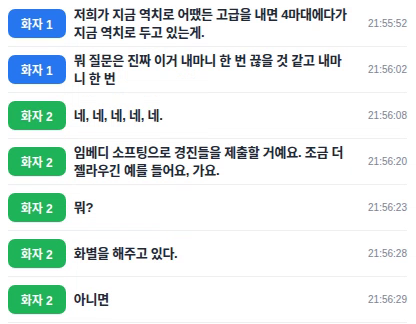

# Live Caption Device

A tabletop device that captions a conversation for deaf and hard-of-hearing people and marks each caption with the person who said it. Four microphones on the housing find the direction of each voice and separate the voices, a depth camera finds the faces, and the device matches each voice direction to a face in the camera view. Every caption then carries that face's number, the same number that is drawn on the face in the camera view beside the caption list. All of it runs on a Jetson Orin Nano inside the device.

Speech-to-text captions show what was said but not who said it, and a deaf user who turns to find the speaker misses the next sentence. Speaksee, one product looked at for the contest report, gives each speaker a microphone to wear; this device sits on the table and the speakers wear nothing. Recognition is in Korean (faster-whisper `small`), the network separates up to three voices at once, and the screen shows finished sentences. Built for the 24th Embedded Software Contest (2026).

| Result | Value | Measured on |
|---|---|---|
| Captions with the right speaker number, two people taking turns 40 degrees or more apart | 95 to 100% (600 captions per angle) | simulation through the device's tracker and face-matching code |
| Speaker number following a new talker, from the start of the turn | median 0.19 s | same simulation |
| Direction published after the end of each 128 ms audio chunk | median 218 ms, 95th percentile 259 ms | device, 6 sessions, 7,719 chunks |
| Direction matched to a face | median 285 ms | device, 1,870 chunks |
| Caption after the speaker stops | median 2.05 s; one talker at a time, 90th percentile 3.42 s | device, 56 captions |
| Direction error of the network, one, two and three talkers | median 5.4, 6.4 and 8.9 degrees | simulated dev set, 1,500 clips |
| Separation gain of the network | 11.67 dB SI-SDR | simulated dev set |
| One talker's azimuth found with the housing's scattering modeled, against a free-field model | median 1.3 against 6.4 degrees | simulation of this housing, 200 scenes |

| Part | |
|---|---|
| Computer | Jetson Orin Nano Super 8 GB, ROS 2 Humble, Python 3.10 |
| Microphones | ReSpeaker 4-Mic Array with its microphones moved onto the housing, raw 6-channel firmware, channels 1 to 4 at 16 kHz |
| Camera | Intel RealSense D455, color 1280 x 800 with aligned depth |
| Display | LCD; the page is laid out for 1024 x 600 |
| Housing | 245 x 174 x 118 mm, two microphones on each end face |

## How it works


1. **Audio in.** The direction and separation node reads the array in 128 ms chunks (2048 samples at 16 kHz), keeps channels 1 to 4, and decimates them to 8 kHz. The STFT uses a 256-sample window (32 ms) with a 128-sample hop (16 ms). Bins outside 150 to 3800 Hz are zeroed, and the spectrum is divided by a running level with a 2 s half-life.
2. **One network, two outputs.** The network keeps its state from one chunk to the next. For each of three slots it returns, for every frame, a direction (a unit vector), an activity between 0 and 1, and a complex spectrum. The direction and activity are averaged over the chunk, and the spectra are turned back into audio by inverse STFT and overlap-add.
3. **Tracks.** Slots with activity of at least 0.3 are assigned to existing tracks by angle with the Hungarian method, accepting pairs within 35 degrees; a slot more than 35 degrees from every track starts a new one. A track is smoothed with a 0.6 s half-life, is published after two matched chunks, and is kept for 32 chunks (4.1 s) after its last match (launch file values). The tracks go out on `sound_source_tracks` with the probability of 0 to 3 voices, a Poisson-binomial distribution of the three activities taken as independent.
4. **Gates.** Tracks are published while the level of the array's own processed channel is at least 0.015 RMS (held for eight chunks), between 30 and 150 degrees azimuth and -10 and 35 degrees elevation, and up to the largest number of faces the camera saw in the last 3 s, keeping the most active. The separated voice of a slot goes out on `separated_audio` with its track id when at least half of its energy is below 1 kHz.
5. **Faces.** The camera node runs MediaPipe BlazeFace (short range) ten times a second. It projects each track direction into the image at 3 m, with the 7 cm offset between the array and the lens, and matches tracks to face centers with the Hungarian method within the pixel radius of 20 degrees.
6. **Speech recognition.** The recognition node opens one streaming session per track, up to four. All sessions share one faster-whisper `small` model, Korean, beam size 5.
7. **Screen.** The page is served on the device at `http://127.0.0.1:8765` (Chromium kiosk mode with `open_browser:=true`). It shows the camera image with the numbered faces and the list of captions.

The axes are those of the array: the origin is the center of the four microphones, +x points out of the end face with M3 and M4, +y is the camera's optical axis, and +z points up. Azimuth is measured from +x toward +y, so a person straight in front of the camera is at 90 degrees.

| Microphone | x (mm) | y (mm) | z (mm) |
|---|---|---|---|
| M1 | -122.50 | 9.50 | 23.59 |
| M2 | -122.50 | -30.49 | -23.59 |
| M3 | 122.50 | 25.20 | -23.59 |
| M4 | 122.50 | -4.20 | 23.59 |

## How a caption gets its number

The faces in each camera frame are numbered from the left, 1 to 3, and each number has its own color in the image and in the caption list (blue, green, orange). When a track is matched to a face, the screen node records that face's number for the track, and a caption from the track carries the number recorded last.

- **A face leaves the view.** Its track keeps its last number, and the faces still in view are numbered again from the left.
- **No face in view, or a voice from outside the view.** The face-count gate opens when no face was seen in the last 3 s, so the tracks are still published, and their captions carry a number from their first face match on.
- **Two talkers.** The tracker tells talkers apart by direction, assigning each voice to a track within 35 degrees.
- **A pause.** A track lasts 4.1 s after its last match, so a speaker who pauses keeps the same track and number. A recognition session finishes a sentence after 0.7 s of silence (0.05 RMS after a gain of 3) and closes 2 s after the last audio or track message for its track; the silence sent to every session when no one speaks does not keep a session open. One recognition runs at a time on the shared model (`_MODEL_INFERENCE_LOCK` in `stt/streaming.py`).

## Design decisions

**Everything on the device.** The alternative was to send audio to a server and run recognition there. With everything on the Jetson, a conversation does not leave the device, the captions do not depend on a network, and the device can be used where audio may not be sent to an outside server, such as schools, public offices and hospitals (contest report pp. 3 and 18).

**Jetson Orin Nano rather than Raspberry Pi 5 with AI HAT+.** The Raspberry Pi 5 with the AI HAT+ was considered first. Its accelerator runs CNNs compiled in advance for a fixed input shape, so a recognition model whose input length changes and the streaming network designed here could not run on it as they are (contest report p. 4). The Jetson's GPU runs the PyTorch model trained on a PC as it is. The 8 GB of memory is shared by the GPU and the CPU, and the network, the recognition model and the camera processing fit in it together.

**Learned direction finding instead of GCC-PHAT and steering-vector matching.** GCC-PHAT was tried first. The microphone pairs that span the body are 245 to 251 mm apart, which leaves phase differences unambiguous only below 682 to 699 Hz (c/2d), so most of the speech band is spatially aliased, and the estimates split into several directions (contest report p. 16). Matching against a table of steering vectors computed from the housing's scattering was tried next. It finds one talker well, but two talkers at once defeat it (table below), and on the Jetson one search over the table of an earlier housing took 119.6 ms, one steering lookup 175.3 ms, and the table used 543 MB. The network finds several talkers at once, estimates how many there are through its activity outputs, and needs no table at run time. The matching code is kept in `bem_matching/`.

`experiments/sim_doa.py` measures the search methods on simulated scenes of this housing. An image-source room with a reverberation time of 0.3 or 0.7 s sends every arrival through the BEM table, diffuse noise from 64 directions comes through the housing at 20 or 5 dB SNR, and one or two talkers (Korean and English speech) stand 1.5 to 3 m away between 30 and 150 degrees azimuth; 50 scenes per condition, the number of talkers given. The same search over a 2 degree grid runs with the BEM steering vectors and with free-field steering vectors from the microphone positions, and SRP-PHAT runs with the free-field vectors.

| Search (simulation, 200 scenes per talker count) | One talker, median azimuth error | One talker, within 10 degrees | Two talkers, within 10 degrees |
|---|---|---|---|
| BEM steering vectors (housing's scattering) | 1.3 deg | 86% | 42% |
| Free-field steering vectors | 6.4 deg | 66% | 38% |
| SRP-PHAT, free field | 8.0 deg | 58% | 31% |

With the housing's scattering modeled, one talker is found five times more precisely than with a free-field model; the single-talker median stays between 0.9 and 1.7 degrees over all four room and noise conditions. Two simultaneous talkers bring every search below half within 10 degrees, while the network's median error with two talkers is 6.4 degrees on its dev set.

**The housing's scattering in the training data.** A free-field model of the four microphones was the alternative. Computed from the BEM table, between M3 and M1 over 300 to 3800 Hz, the level difference reaches 41.1 dB where a free-field plane wave gives none, and the time difference ranges from -800 to +858 microseconds instead of plus or minus 716; the table above shows what modeling these cues does for a search. The surface pressure on the housing was computed with the boundary element method (BEM) for every direction on a 1 degree grid (360 x 181 = 65,160 directions) and 257 frequencies from 0 to 4 kHz, and the training audio was rendered through it.

**Microphones on two opposite faces.** Putting all four microphones on one face was the alternative. On the earlier box-shaped housing, in simulation (400 single-speaker scenes of 1 s, the same rooms and noise for both layouts), the one-face layout had a median error of 7.1 degrees in front of the array and 16.4 degrees behind it, and the two-face layout 7.3 and 7.4. The device places two microphones on each end face, offset in height.

**Mamba-3 state size 16 rather than 64.** One narrow-band block took 1.15 ms with state size 16 and 1.16 ms with 64 (RTX 4060 Ti, 129 frequencies, 251 frames), and the state is 4.36 MB against 16.69 MB per block.

**Tracks that survive pauses.** At first a track ended at every short pause between sentences, a new track started, and since each track had its own recognition session, one sentence came out as several fragments (contest report p. 16). A track is now kept for 4.1 s after its last match, and a recognition session belongs to a track and closes when nothing has arrived for that track for 2 s.

**MediaPipe instead of a Haar cascade.** With the OpenCV Haar cascade, the face was lost when a speaker turned their head, and the caption lost its speaker label (contest report p. 16). MediaPipe BlazeFace keeps turned faces and returns the same face boxes to the matching code.

**Whisper small rather than tiny or base.** On the Jetson CPU with int8 the real-time factors were 0.19 for tiny, 0.18 for base and 0.48 for small. Tiny and base misrecognized lecture terms such as the Korean for "linear regression", and small recognized them.

## Implementation notes

**One network for direction and separation.** One trunk feeds a separation head and a direction head (`model/net_v3.py`), so the blocks run once per chunk for both outputs. The direction head also gives each slot an activity, which the tracker uses to decide which slots hold a voice.

**Streaming narrow-band blocks.** The blocks follow the cross-band and narrow-band layout of SpatialNet. Both modules of each narrow-band block are Mamba-3 layers (`model/mamba_block.py`), and the state of each layer is carried from one chunk to the next, so the network runs on a stream of 128 ms chunks.

**CHIEF in the boundary element solution.** To suppress the interior resonances at which the plain boundary integral equation loses its unique solution, 20 interior CHIEF points were added and the system was solved by least squares (contest report p. 8). The mesh was remeshed to 8,364 elements with a longest edge of 11.79 mm, below one sixth of the wavelength at 4 kHz (14.29 mm).

**Separate ROS 2 nodes.** Direction and separation, face detection, recognition and the screen run as separate processes because they run at different rates and loads (contest report p. 4). They exchange fixed messages, and the topics are recorded with rosbag, which is how the device checks below were made. Sensor topics are sent best-effort with queues of 5 or 10 messages, and captions reliably with a queue of 50.

**Final results ahead of partial ones.** Each session has one worker. A final result waits in a queue and is served before any partial one, and only the newest partial request is kept. The launch file sets the partial interval to one day, so the screen shows final sentences.

## Training data

Each clip is a 4 s scene at 8 kHz, rendered for the four microphones of the device. A room of 5 to 12 m by 5 to 12 m with a 2.4 to 3.5 m ceiling and a reverberation time of 0.2 to 1.3 s is drawn at random. The device stands on a desk 0.72 to 0.78 m high. Zero to three speakers are placed 2.0 to 4.5 m away, seated (mouth 1.04 to 1.21 m) or standing (mouth 1.40 to 1.74 m). Each voice is rendered through the room and the BEM table, and diffuse noise shaped by the housing is added at -5 to 15 dB SNR.

| | |
|---|---|
| Clips (train, dev, test) | 15,000, 1,500, 1,500 |
| Speakers per clip (0, 1, 2, 3) | 11.8, 29.4, 29.2, 29.6 % |
| Speech | LibriSpeech (13,393 utterances) and Zeroth-Korean (13,094 utterances) |
| Talkers (train, dev, test) | 346, 50, 50, no overlap |
| Separation between speakers | median 12.8 degrees |

The labels were checked against the audio: the delay between each microphone pair predicted from the labeled direction and the delay measured with GCC-PHAT had a correlation of 0.968, and 97.9% of them agreed within one sample. A second set of 21,000 clips adds speech from behind the device (4,176 clips) and non-speech sounds (5,204 clips), and a third has 6,000 clips of 32 s.

## Network


| | |
|---|---|
| Input | real and imaginary STFT of 4 channels, 129 bins |
| Input layer | causal convolution over time, kernel 5 |
| Blocks | 8 x (cross-band, narrow-band) |
| Cross-band | frequency convolution (kernel 3, 8 groups), full-band linear layer shared by all blocks, frequency convolution |
| Narrow-band | two Mamba-3 layers, state size 16, head size 64 |
| Width | 128 |
| Separation head | 1 x 1 convolution to a complex spectrum for 3 slots, per frame |
| Direction head | softmax-weighted sum over bins, two 1 x 1 convolutions with GELU between; per slot and frame a normalized 3D vector and a sigmoid activity |
| Parameters | 1,978,851 |

Training uses permutation-invariant assignment of slots to speakers and three losses: one minus the cosine between the estimated and true directions on active frames, binary cross-entropy on activity, and negative SI-SDR on the separated voice. An earlier version trained with an L1 loss on the complex spectrum converged to silent output, whose L1 loss equals the target's own size; SI-SDR has no such minimum at silence, and with it the separation gain on the dev set reached 11.67 dB after 30 epochs.

On the dev set (1,500 simulated clips, after 30 epochs) the direction error was:

| Talkers at once | Mean (deg) | Median (deg) | 90th percentile (deg) |
|---|---|---|---|
| 1 | 6.3 | 5.4 | 11.4 |
| 2 | 7.7 | 6.4 | 12.9 |
| 3 | 10.3 | 8.9 | 18.2 |

On three-talker test clips this model pulled the estimated directions toward the middle of the group: the spread of the estimated azimuths was 0.47 of the true spread on 425 clips and 0.33 on 12 clips with the talkers placed far apart. The training scenes had put simultaneous talkers close together (median 12.8 degrees apart), and fine-tuning on scenes with wider separation raised the ratio to 0.71 and 0.62 and lowered the direction error on the 12 far-apart clips from 22.8 to 13.5 degrees.

## Checks

The device checks come from six sessions recorded on the device on 2 September 2026, 987 s of direction messages. The event tables taken from those rosbags are in `results/events/`, the simulation results in `results/`, and every number and figure in this section is rebuilt from them with:

```sh
python experiments/summarize.py results/events --figures docs/src
python experiments/summarize_sim.py --figures docs/src
cd docs/src && sh build.sh
```

### Speaker numbers


`experiments/sim_labels.py` runs two people taking turns, 2 m from the device, through the repository's tracker (`model/tracker.py`, launch file settings), the gates, the camera node's projection (`camera_node/node.py`) with a Hungarian match within 20 degrees, and the screen's numbering. The network is replaced by one active slot per chunk pointing at the talker, with a direction error whose median equals the network's on single-talker dev clips (5.4 degrees). Each run has 20 turns of 1.5 to 4 s with pauses of 0.8 to 1.5 s, and each caption takes its track's number 2.0 s after the turn ends, the median measured on the device. With 30 runs per angle (600 captions):

| Angle between the talkers (deg) | 35 | 40 | 50 | 60 | 90 |
|---|---|---|---|---|---|
| Captions with the right number (%) | 63.3 | 95.3 | 100 | 100 | 100 |
| Number follows the new talker, median (s) | 0.26 | 0.20 | 0.18 | 0.19 | 0.19 |

At 40 degrees and more each talker keeps a track of their own, and 95 to 100% of the captions carry the talker's face number. The time for the number to follow a new talker is mostly the two chunks a new track needs before it is published; on the device the 285 ms to a face match comes on top.


On the device the two people of session 3 (contest report p. 15) sat about 45 degrees apart. From 27 s to 97 s their tracks alternate between about 110 degrees and 60 to 72 degrees, and once matched, the tracks near 110 degrees have number 1 and those near 60 to 72 degrees number 2 (`experiments/bag_events.py` replays the screen's numbering on the recorded face messages).



The caption list above is cut from a screen recording made on the device on 30 August 2026. The sentences are in Korean, and the label on the left of each reads "speaker 1" or "speaker 2".

| Session | 1 | 2 | 3 | 4 | 5 | 6 | All |
|---|---|---|---|---|---|---|---|
| Length (s) | 136.7 | 148.5 | 136.5 | 134.9 | 122.5 | 322.5 | 1,001.6 |
| Most faces in one camera frame | 1 | 1 | 3 | 3 | 1 | 1 | |
| Chunks with a published track | 322 | 390 | 545 | 693 | 292 | 551 | 2,793 |
| of these, matched to a face | 237 | 353 | 305 | 230 | 198 | 547 | 1,870 (67%) |
| Final captions with text, from a separated voice | 7 | 10 | 3 | 9 | 6 | 8 | 43 |
| of these, with a speaker number | 7 | 10 | 2 | 9 | 6 | 8 | 42 |

In session 6 the screen's switch that sends the array's own channel to recognition was on for 1,806 of 2,520 chunks, and 13 more captions came from that channel.

### Timing on the device

![Top left: interval between recorded direction messages; one interval of 1,519 ms lies beyond the axis. Top right: delay from the last sample of each 128 ms chunk to the recorded direction message (all 7,719 chunks) and to the first recorded face match (the 1,870 matched chunks); 15 direction delays of 451 to 1,594 ms lie beyond the axis. Bottom left: every direction message of session 3 from 97 s to 109 s; the grey band is the 1,519 ms with no direction message. Bottom right: time from the end of a track's voice to its caption; captions over 6 s are in the last bin.](docs/timing.png)

The nodes and the recorder share the Jetson's clock. The header of each direction message carries the audio time of the first sample of its 128 ms chunk, and every delay is measured from the chunk's last sample to the time rosbag recorded the message. The face match is the camera node's first `faces` message that carries the chunk's time as its source stamp and attaches a track to a face; the camera node runs every 100 ms, so this includes the wait for its next cycle. The end of speech is the end of the last chunk in which the track's separated voice was above the recognition node's silence threshold, before a pause of 0.7 s.

| | |
|---|---|
| Interval between direction messages, mean | 128.0 ms in every session |
| Interval, median and 99th percentile | 123.9 ms and 180.3 ms |
| Delay to the direction message, median and 95th percentile | 218 ms and 259 ms (199 to 239 ms per session) |
| Delay to the first face match, median and 95th percentile | 285 ms and 351 ms (268 to 309 ms per session) |
| End of speech to caption, median | 2.05 s (56 captions) |
| with at most one track speaking in the 10 s before | 2.03 s, 90th percentile 3.42 s (50 captions) |

The mean interval equals the chunk length in every session, and the delay over the last tenth of each session is within 2 ms of the delay over the first tenth, so the network keeps up with the audio. Once, in session 3 from 102.3 s to 103.8 s, no direction message was recorded for 1,519 ms; the next 15 messages carried the waiting chunks, and 0.78 s after the gap the delay was back at 195 ms. Each STFT block reaches 16 ms into the next chunk, so the estimate for a chunk is computed once the next chunk has arrived, and the delay includes that wait. Five of the six captions that came more than 5 s after the end of speech followed a period in which two or three tracks had spoken within 10 s, when the recognition sessions take turns on the shared model.

### Where the numbers come from

| Numbers | Input | Run on | Record |
|---|---|---|---|
| Device timing and speaker numbers | six rosbags of 2 September 2026 | Jetson (recording), PC (analysis) | `results/events/`, `experiments/summarize.py` |
| Speaker numbers in simulation | 8 angles x 2 error levels x 30 runs x 20 turns | PC | `experiments/sim_labels.py`, `results/sim_labels.csv` |
| Search methods on this housing | 4 conditions x 2 talker counts x 50 scenes | PC | `experiments/sim_doa.py`, `results/sim_doa.csv` |
| Network direction error and separation gain | 1,500 simulated dev clips | training server | contest report draft |
| Steering-vector search time on the Jetson | table of the earlier housing | Jetson | contest report draft |
| Scattering cues | BEM table, M3 and M1, 300 to 3800 Hz | PC | contest report draft |
| Layout comparison | 400 simulated single-speaker scenes of 1 s, earlier housing | PC | contest report draft |
| Block time | 129 frequencies, 251 frames | RTX 4060 Ti | contest report draft |
| Whisper real-time factors | Korean speech | Jetson CPU, int8 | contest report draft |

## Topics

| Topic | Type | From | To |
|---|---|---|---|
| `sound_source_tracks` | `SoundSourceTracks` | direction and separation | camera, recognition, screen |
| `separated_audio` | `SeparatedAudio` | direction and separation | recognition |
| `faces` | `Faces` | camera | direction and separation, screen |
| `camera/compressed` | `sensor_msgs/CompressedImage` | camera | screen |
| `caption` | `Caption` | recognition | screen |
| `caption_reset`, `model_enabled`, `stt_raw_audio` | `std_msgs` | screen | other nodes |

## Repository

```text
ros2_ws/src/captioning_msgs/       message definitions
ros2_ws/src/doa_separation_node/   microphone input, network, tracker, gates
  model/net_v3.py                  network
  model/mamba_block.py             narrow-band block with streaming state
  model/streaming_net.py           chunked STFT, inference, overlap-add
  model/tracker.py                 track assignment and smoothing
ros2_ws/src/camera_node/           RealSense, face detection, track to face matching
ros2_ws/src/stt_bridge_node/       one recognition session per track
  stt_module/stt/streaming.py      session, final and partial scheduling
ros2_ws/src/ui_bridge_node/        screen server and launch file for the whole device
bem_matching/                      steering-vector matching against the BEM table
experiments/bag_events.py          event tables from the rosbags
experiments/summarize.py           device numbers and figure data from the event tables
experiments/sim_labels.py          speaker numbers for two people taking turns, simulated
experiments/sim_room.py            room and housing renderer for the simulations
experiments/sim_doa.py             search methods on simulated scenes of this housing
experiments/summarize_sim.py       tables and figure data from the simulations
experiments/field_check.py         steering-vector matching on recordings
results/                           event tables, per-session values and simulation results
docs/                              figures; docs/src holds their sources and build script
```

## Build and run

On the Jetson, with ROS 2 Humble, PyTorch with CUDA, `faster-whisper`, `sounddevice`, `pyrealsense2` and `mediapipe` installed, and `mamba-ssm` installed with `MAMBA_SKIP_CUDA_BUILD=TRUE pip install --user --no-deps --no-build-isolation mamba-ssm==2.3.2.post1`:

```sh
cd ros2_ws
colcon build --symlink-install
source install/setup.bash
ros2 launch ui_bridge_node captioning.launch.py
```

Put the network checkpoint in `ros2_ws/src/doa_separation_node/weights/` before building, or pass it with the `weights` parameter of the direction and separation node.

The sessions were recorded on the Jetson, while the device was running, with:

```sh
ros2 bag record -o <directory> /sound_source_tracks /separated_audio /faces /caption /camera/compressed /doa_debug
```

From such recordings, and for the simulations, on a PC with Python, NumPy, SciPy and h5py:

```sh
python experiments/bag_events.py <bag directories> --out results/events
python experiments/sim_labels.py --out results/sim_labels.csv
python experiments/sim_doa.py <BEM table .h5> <speech .wav files> --out results/sim_doa.csv
```

`summarize.py` and `summarize_sim.py` print every value in the Checks tables and write the figure data; `docs/src/build.sh` needs pdflatex with TikZ and pgfplots, and PyMuPDF.
